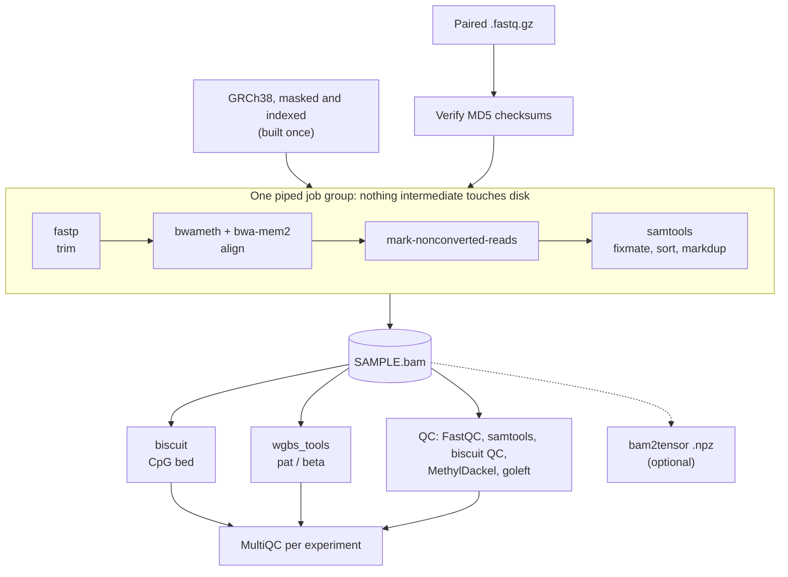

# Serpent Methylation Pipeline

[](https://github.com/semenko/serpent-methylation-pipeline/releases)
[](https://github.com/semenko/serpent-methylation-pipeline/actions/workflows/main.yml)
[](https://semenko.github.io/serpent-methylation-pipeline/)
[](https://snakemake.github.io)
[](LICENSE)


A standardized, reproducible pipeline for WGBS bisulfite and EM-seq data. It goes from `.fastq.gz` to methylation calls, aligning with [bwameth](https://github.com/brentp/bwa-meth) on [bwa-mem2](https://github.com/bwa-mem/bwa-mem2) and calling with [biscuit](https://github.com/huishenlab/biscuit), with extensive QC, all in one Snakemake file.

**[Read the documentation](https://semenko.github.io/serpent-methylation-pipeline/)** for installation, configuration, usage, the reasoning behind each step, and output formats.

## Quick Start

Real runs need **Linux**, at least 4 cores and roughly 128 GB of RAM. Dry runs work anywhere.

```bash
git clone https://github.com/semenko/serpent-methylation-pipeline.git
cd serpent-methylation-pipeline
mamba install -c conda-forge -c bioconda snakemake snakemake-storage-plugin-http

# Show the plan for the bundled test sample
snakemake --cores 4 --use-conda --dry-run

# Run it
snakemake --cores 4 --use-conda --printshellcmds --rerun-incomplete --keep-going --rerun-triggers mtime
```

Before a real run, install [wgbs_tools](https://github.com/nloyfer/wgbs_tools) by hand (it is not on conda): see [Installation](https://semenko.github.io/serpent-methylation-pipeline/installation.html).

## Your Samples

Each `data/EXPERIMENT.csv` defines one experiment, with one row per sample, and every experiment in `data/` is run. Reads go in `data/EXPERIMENT/SAMPLE_ID/raw/`. [data/test.csv](data/test.csv) is a working example, and [Configuration](https://semenko.github.io/serpent-methylation-pipeline/configuration.html) lists the columns.

## Run Modes

| Add to the command | What it does |
| --- | --- |
| nothing | Full analysis of every sample. |
| `--config make-subsampled=True` | Only writes subsampled reads (5M read pairs per sample) to `data/EXPERIMENT_subsampled/`. |
| `--config analyze-subsampled=True` | Full analysis of the subsampled reads only. |
| `--config bam2tensor=True` | Also exports read-level methylation tensors with [bam2tensor](https://github.com/mcwdsi/bam2tensor) (needs `pip install bam2tensor`). |
| `--config ntfy_topic=TOPIC` | Sends [ntfy.sh](https://ntfy.sh) notifications to your topic. |

## How It Works



Results land in `data/EXPERIMENT/SAMPLE_ID/`: see [Output Format](https://semenko.github.io/serpent-methylation-pipeline/output_format.html). The choices behind each step (reference build and masking, trimming lengths, minimal quality filtering) are explained in [Pipeline Details](https://semenko.github.io/serpent-methylation-pipeline/pipeline_details.html).

## Citing

If you use this pipeline, please cite it with GitHub's "Cite this repository" button (from [CITATION.cff](CITATION.cff)), and name the release you ran.

## Contributing

Issues and pull requests are welcome. Run the checks in [AGENTS.md](AGENTS.md#checks) before opening a pull request. AI coding agents should read [AGENTS.md](AGENTS.md) first.

## License

[MIT](LICENSE)
