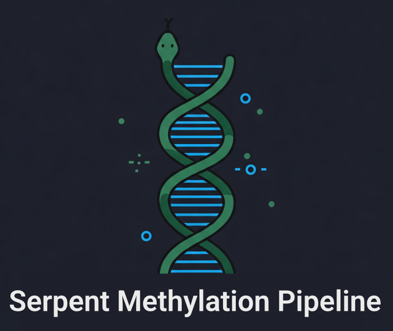

# Serpent Methylation Pipeline (for Snakemake)

[](https://snakemake.github.io)
[](https://opensource.org/licenses/MIT)
[](https://github.com/psf/black)
[](https://www.linux.org/)
[](https://github.com/semenko/serpent-methylation-pipeline/actions/workflows/main.yml)
[](https://semenko.github.io/serpent-methylation-pipeline/)



A standardized, reproducible pipeline to process WGBS bisulfite & EM-seq data. It goes from `.fastq` to methylation calls (aligning with [bwameth](https://github.com/brentp/bwa-meth) on [bwa-mem2](https://github.com/bwa-mem/bwa-mem2), calling with [biscuit](https://github.com/huishenlab/biscuit)) and includes extensive QC and plotting, all in one Snakemake file.

**[Full documentation](https://semenko.github.io/serpent-methylation-pipeline/)**: installation, configuration, usage, pipeline details and output formats.

## Quick Start

The pipeline runs on **Linux only** (several dependencies, such as `bwa-mem2`, are not built for macOS).

1. Clone this repository and open the directory:
   ```bash
   git clone https://github.com/semenko/serpent-methylation-pipeline.git
   cd serpent-methylation-pipeline
   ```
2. Install Snakemake (8 or newer) via [mamba](https://github.com/conda-forge/miniforge) (or conda):
   ```bash
   mamba install -c bioconda -c conda-forge snakemake snakemake-storage-plugin-http
   ```
3. Install [wgbs_tools](https://github.com/nloyfer/wgbs_tools) by hand. It is not on conda, so `--use-conda` cannot provide it. Put `wgbstools` on your `PATH` and initialize a genome named `GRCh38-DAC-U2AF1` from the masked reference the pipeline builds (`data/reference/GRCh38-DAC-U2AF1.fna`). Everything else comes from [env.yaml](workflow/envs/env.yaml).
4. Check the execution plan for the bundled test sample (this needs network access):
   ```bash
   snakemake --cores 4 --use-conda --dry-run
   ```
5. Run it:
   ```bash
   snakemake --cores 4 --use-conda --printshellcmds --rerun-incomplete --keep-going --rerun-triggers mtime
   ```

The pipeline needs at least 4 cores. The first run downloads GRCh38 and builds the bwa-mem2 and biscuit indices, which takes hours and tens of GB of RAM and disk.

## Defining Samples

Each `data/EXPERIMENT.csv` defines one experiment, and every experiment found in `data/` is run. Reads live in `data/EXPERIMENT/SAMPLE_ID/raw/`. A working example is [data/test.csv](data/test.csv).

| Column | Required | Meaning |
| --- | --- | --- |
| `sample_id` | yes | Sample name and directory name. Must be unique across all experiments. |
| `path_R1`, `path_R2` | yes | Paired `.fastq.gz` filenames inside the sample's `raw/` directory. |
| `method` | yes | `emseq` or `bsseq` (case and hyphens are ignored). Controls trimming. |
| `md5sum_R1`, `md5sum_R2` | yes | Known MD5 sums of the reads, verified before anything else runs. |
| anything else | no | Free-form metadata. The pipeline ignores it. |

Rows missing a required value are skipped with a warning.

## Run Modes

| Command | What it does |
| --- | --- |
| `snakemake ...` | Full analysis of every sample. |
| `snakemake ... --config make-subsampled=True` | Only writes subsampled reads (5M read pairs per sample) to `data/EXPERIMENT_subsampled/`. |
| `snakemake ... --config analyze-subsampled=True` | Full analysis of the subsampled reads only (generating them first if missing). |
| `snakemake ... --config ntfy_topic=TOPIC` | Sends [ntfy.sh](https://ntfy.sh) notifications (per finished sample, and on overall success/failure) to your topic. Off by default. |

[workflow/analyze-subsamples.sh](workflow/analyze-subsamples.sh) runs the two subsampling steps back to back.

## What It Does

- Builds a reference genome (GRCh38 with the hs38d1 decoy, U2AF1 and ENCODE DAC masking)
- Trims & filters reads using [fastp](https://github.com/OpenGene/fastp)
- Aligns using [bwameth](https://github.com/brentp/bwa-meth) with the [bwa-mem2](https://github.com/bwa-mem/bwa-mem2) backend
- Marks non-converted reads using [mark-nonconverted-reads](https://github.com/nebiolabs/mark-nonconverted-reads)
- Marks duplicates with [samtools](https://github.com/samtools/samtools)
- Calls methylation using [biscuit](https://github.com/huishenlab/biscuit) pileup
- Generates standardized outputs & QC:
  - [FastQC](https://www.bioinformatics.babraham.ac.uk/projects/fastqc/)
  - [fastp](https://github.com/OpenGene/fastp) statistics
  - [biscuit QC](https://huishenlab.github.io/biscuit/)
  - [samtools stats](https://github.com/samtools/samtools)
  - [MethylDackel mbias plots](https://github.com/dpryan79/MethylDackel)
  - [goleft indexcov plots](https://github.com/brentp/goleft)
  - [wgbs_tools](https://github.com/nloyfer/wgbs_tools) pat/beta files
  - Compressed, indexed bed files of CpG methylation
- Runs [MultiQC](https://multiqc.info) across each experiment

## Output

    data/
    ├── reference/                  # Masked GRCh38 and indices (built once, shared)
    ├── EXPERIMENT.csv              # Your sample definitions
    └── EXPERIMENT/
        ├── SAMPLE_01/
        │   ├── SAMPLE_01.bam       # Sorted, duplicate-marked alignment (write-protected)
        │   ├── SAMPLE_01.bam.bai
        │   ├── beds/               # CpG methylation calls (bgzipped bed + tabix index)
        │   ├── biscuit/            # biscuit QC
        │   ├── fastp/              # Trimming statistics
        │   ├── fastqc/
        │   ├── goleft/             # Coverage plots
        │   ├── logs/               # Logs and benchmarks from each step
        │   ├── methyldackel/       # mbias plots
        │   ├── raw/                # Your raw reads, plus md5 checksums and validation
        │   ├── samtools/           # samtools statistics
        │   └── wgbs_tools/         # pat/beta files
        ├── SAMPLE_02/
        │   └── ...
        └── multiqc/                # Experiment-level MultiQC report

`data/EXPERIMENT_subsampled/` has the same structure for the subsampled runs. To redo a sample from scratch, delete everything in its directory except `raw/`.

## Pipeline Details

This pipeline was designed for highly reproducible, explainable alignments and analysis of epigenetic sequencing data.

### Reference Genome

I chose **GRCh38**, with these specifics:
- No patches
- Includes the hs38d1 decoy
- No ALT contigs
- Applies the [U2AF1 masking file](https://genomeref.blogspot.com/2021/07/one-of-these-things-doest-belong.html)
- Applies the [ENCODE DAC exclusion list](https://www.encodeproject.org/annotations/ENCSR636HFF/)

You can see a good explanation of the rationale for some of these components at [this NCBI explainer](https://ftp.ncbi.nlm.nih.gov/genomes/all/GCA/000/001/405/GCA_000001405.15_GRCh38/seqs_for_alignment_pipelines.ucsc_ids/README_analysis_sets.txt).

### Tools

Software requirements are specified in [env.yaml](workflow/envs/env.yaml). Most are common, but a few are semi-unique:
- [bwameth](https://github.com/brentp/bwa-meth) with bwa-mem2 (alignment)
- [biscuit](https://github.com/huishenlab/biscuit) (methylation calling and QC)
- NEB's [mark-nonconverted-reads](https://github.com/nebiolabs/mark-nonconverted-reads) (marks partially converted reads)
- [wgbs_tools](https://github.com/nloyfer/wgbs_tools) (pat/beta files; installed by hand, and note its license is restrictive)

Alignment originally used biscuit, which writes very well annotated `.bam` files and supports SNV calling, but takes roughly 30 hours per sample on a 40-core machine. bwameth on bwa-mem2 is far faster. The biscuit alignment rule is kept, commented out, in the Snakefile.

### Trimming Approach

I chose a relatively conservative approach to trimming, which is needed due to end-repair bias, adaptase bias, and more.

For **EM-seq**, I trim 10 bp everywhere, after personal QC and offline discussions with NEB. See [my notes here](https://github.com/FelixKrueger/Bismark/issues/509).

For **BS-seq**, I trim 15 bp from the 5' end of R2, and 10 bp everywhere else, due to adaptase bias.

For all reads, TruSeq adapters are given explicitly, and reads shorter than 15 bp after trimming are dropped.

### Quality Filtering

Quality filtering is deliberately minimal: fastp runs with only its default filter (it drops reads where more than 40% of bases are below Q15, or with more than 5 Ns), and nothing stricter. I experimented with more stringent quality filtering early on, and found it had little yield / performance benefit, so further filtering is left to downstream analyses.

## Background & Inspiration

I strongly suggest reading work from Felix Krueger (author of Bismark) as background. In particular:
- TrimGalore's [RRBS guide](https://github.com/FelixKrueger/TrimGalore/blob/master/Docs/RRBS_Guide.pdf)
- The Babraham [WGBS/RRBS tutorials](https://www.bioinformatics.babraham.ac.uk/training.html#bsseq)

For similar pipelines and inspiration, see:
- NEB's [EM-seq pipeline](https://github.com/nebiolabs/EM-seq/)
- Felix Krueger's [Nextflow WGBS Pipeline](https://github.com/FelixKrueger/nextflow_pipelines/blob/master/nf_bisulfite_WGBS)
- The Snakepipes [WGBS pipeline](https://snakepipes.readthedocs.io/en/latest/content/workflows/WGBS.html)

## Pipeline Graph

Here's a high-level overview of the Snakemake pipeline (generated via `snakemake --rulegraph | dot -Tpng > rules.png`)


## For AI Agents

If you are an AI coding agent working in this repository, read [AGENTS.md](AGENTS.md) first. The short version:

- The whole pipeline is one file, [workflow/Snakefile](workflow/Snakefile). Keep it that way; do not split it into modules.
- Validate every change with `snakemake --cores 4 --dry-run` in all three run modes, plus `snakemake --lint` and `snakefmt --check workflow/Snakefile`. These work on any OS and need only network access.
- Never start a real run to test a change. It downloads a human genome and needs a large Linux machine.
- Do not change scientific defaults (trimming lengths, thresholds, the reference build, tool choices) unless you were asked to.
- Never edit, move or delete anything under `data/` other than the experiment `.csv` files.
- When behavior changes, update this README and `docs/` in the same change.

## Support & Contributing

- **Documentation**: <https://semenko.github.io/serpent-methylation-pipeline/>
- **Issues**: [GitHub Issues](https://github.com/semenko/serpent-methylation-pipeline/issues)

Pull requests are welcome. Please run the checks listed in [AGENTS.md](AGENTS.md#checks) before opening one.

## License

[MIT](LICENSE)
